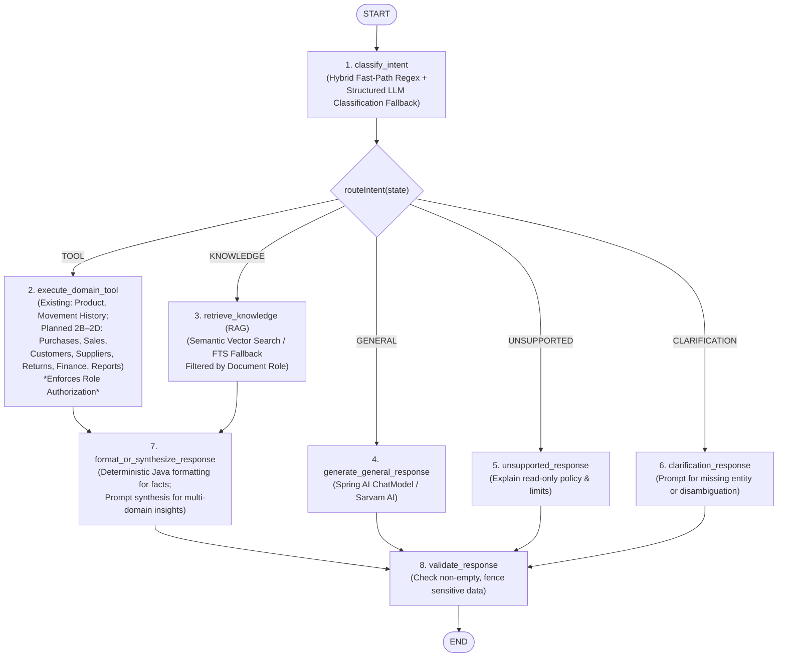

# Auto Parts ERP AI Assistant: Architecture Specification

## 1. Architectural Principles and Separation of Concerns

The Auto Parts ERP AI assistant is built as a modular, decoupled system where each layer has a strictly delineated responsibility:

```
+-----------------------------------------------------------------------------------+
|                              Web / REST Client                                    |
+-----------------------------------------------------------------------------------+
                                         |  Bearer JWT
                                         v
+-----------------------------------------------------------------------------------+
|                        AiAssistantController (/api/v1/ai)                         |
|   - Authenticates user subject via Spring Security                                |
|   - Conversation endpoints (chat, history, rename, archive, cancel)               |
+-----------------------------------------------------------------------------------+
                                         |
                                         v
+-----------------------------------------------------------------------------------+
|                        AiAssistantService (Lifecycle & DB)                        |
|   - Enforces conversation ownership (user_subject)                                |
|   - Persists USER / ASSISTANT messages (ai_messages)                              |
|   - Tracks run status in ai_agent_runs (RUNNING, COMPLETED, FAILED, CANCELLED)    |
|   - Handles concurrency lock (AiExecutionInProgressException)                    |
+-----------------------------------------------------------------------------------+
                                         |
                                         v
+-----------------------------------------------------------------------------------+
|                      ErpAiAgentService (LangGraph4j 1.9.7)                        |
|   - CompiledGraph<ErpAiGraphState> execution pipeline                             |
|   - Manages ActiveExecution, 60s Scheduled timeout, and cooperative cancellation  |
+-----------------------------------------------------------------------------------+
                                         |
         +-------------------------------+-------------------------------+
         |                               |                               |
         v                               v                               v
+------------------+           +---------------------------------------------+           +-------------------+
| Orchestration    |           | Read-Only Tools (Spring JDBC)               |           | Knowledge / RAG   |
| (LangGraph4j)    |           | Existing (Stage 1/2A):                      |           | (PostgreSQL /     |
| - StateGraph     |           | - ProductLookupTool                         |           |  Spring AI)       |
| - Design Schema: |           | - InventoryHistoryLookupTool                |           | - Semantic vector |
|   Typed Channels |           | Planned (Stage 2B–2D):                      |           |   search (pgvector|
|   (Pending 2B)   |           | - Low-Stock Tool (2B)                       |           |   or FTS fallback)|
| - Routing edges  |           | - PurchaseAiTools (2C)                      |           | - Grounded SOPs   |
| - Intent dispatch|           | - SalesAiTools (2C)                         |           | - Warranty rules  |
+------------------+           | - CustomerAiTools (2C)                      |           | - Document roles  |
                               | - SupplierAiTools (2C)                      |           +-------------------+
                               | - ReturnAiTools (2D)                        |
                               | - FinancialAiTools (2D)                     |
                               | - ReportAiTools (2D)                        |
                               +---------------------------------------------+
                                         |
                                         v
+-----------------------------------------------------------------------------------+
|                       Existing ERP Services & Repositories                        |
|   - CustomerLedgerRepository, SupplierLedgerRepository, AdvancedReportRepository  |
|   - Parameterized SQL via aiToolJdbcTemplate (30s query timeout)                  |
|   - Strictly READ-ONLY operations (No write mutations permitted in Stage 2)       |
|   - *Prerequisite*: Live PostgreSQL schema & repository verification before coding|
+-----------------------------------------------------------------------------------+
                                         |
                                         v
+-----------------------------------------------------------------------------------+
|                       Spring Security (Backend Enforcement)                       |
|   - Method security: @AdminOnly, @AdminOrManager, @SalesAccess                    |
|   - Tool-level role inspection: Cashier vs Manager vs Admin                       |
|   - Independent of LLM prompt instructions (Zero Trust LLM)                       |
+-----------------------------------------------------------------------------------+
```

---

## 2. Verified LangGraph4j 1.9.7 State & Channel Architecture

### Exact API Signatures Verified from `langgraph4j-core-1.9.7.jar`

LangGraph4j 1.9.7 defines state channels through the `org.bsc.langgraph4j.state.Channels` factory interface and `BaseChannel<T>`:

```java
package org.bsc.langgraph4j.state;

public interface Channels {
    // 1. Appender channels for collections (with or without duplicates)
    static <T> Channel<List<T>> appender(Supplier<List<T>> defaultProvider);
    static <T> Channel<List<T>> appenderWithDuplicate(Supplier<List<T>> defaultProvider);

    // 2. Base channels with default provider (replaces current value when reducer is null)
    static <T> Channel<T> base(Supplier<T> defaultProvider);

    // 3. Base channels with reducer (applies reducer BiFunction<T, T, T> on state updates)
    static <T> Channel<T> base(Reducer<T> reducer);
    static <T> Channel<T> base(Reducer<T> reducer, Supplier<T> defaultProvider);
}
```

In `BaseChannel<T>`, when `reducer` is null, any partial state update replaces the existing channel value:
`return (newValue != null) ? newValue : defaultProvider.get();`

### Typed `ErpAiGraphState` Channel Schema (Design Specification — Pending Java Implementation in Stage 2B)

> [!NOTE]
> In the current codebase (`src/main/java/com/autoparts/erp/ai/service/ErpAiGraphState.java`), `SCHEMA` is currently initialized as `Map.of()` (untyped). The following typed schema using `Channels.base(...)` is a **design specification to be implemented in Java during Stage 2B**.
>
> Furthermore, as established by DEC-004 and DEC-010, **graph state is never the authorization authority**. While `userRoles` may be retained in state for workflow logging or routing, all access control decisions are strictly governed by the immutable `ErpAiExecutionContext` passed directly to tool execution boundaries.

The target design schema for `ErpAiGraphState` is formally defined as:

```java
public class ErpAiGraphState extends AgentState {

    public static final Map<String, Channel<?>> SCHEMA = Map.of(
            "conversationId", Channels.base(() -> ""),
            "currentMessage", Channels.base(() -> ""),
            "history", Channels.base(ArrayList::new),
            "intent", Channels.base(() -> ""),
            "entities", Channels.base(HashMap::new),
            "userRoles", Channels.base(ArrayList::new),
            "toolResult", Channels.base(() -> null),
            "toolError", Channels.base(() -> ""),
            "clarificationMessage", Channels.base(() -> ""),
            "finalResponse", Channels.base(() -> "")
    );

    public ErpAiGraphState(Map<String, Object> initData) {
        super(initData);
    }

    public String conversationId() { return text("conversationId"); }
    public String currentMessage() { return text("currentMessage"); }
    public String intent() { return text("intent"); }
    public String toolError() { return text("toolError"); }
    public String clarificationMessage() { return text("clarificationMessage"); }
    public String finalResponse() { return text("finalResponse"); }

    @SuppressWarnings("unchecked")
    public Map<String, Object> entities() {
        return value("entities").map(Map.class::cast).orElse(Map.of());
    }

    @SuppressWarnings("unchecked")
    public List<String> userRoles() {
        return value("userRoles").map(List.class::cast).orElse(List.of());
    }
}
```

---

## 3. LangGraph4j Workflow Graph Structure



---

## 4. Security & Role Authorization Matrix

Verified directly against existing annotations in `com.autoparts.erp.auth.security.annotation` and service implementations:

* `@AdminOnly`: `hasRole('ADMIN')`
* `@AdminOrManager`: `hasAnyRole('ADMIN', 'MANAGER')`
* `@SalesAccess`: `hasAnyRole('ADMIN', 'MANAGER', 'CASHIER')`
* `@AuthenticatedUser`: `isAuthenticated()`

### Domain Tool Access Matrix

| ERP Domain / Tool Operation | Backend Service Equivalent | Minimum Required Role | Cashier Access | Manager Access | Admin Access |
| :--- | :--- | :--- | :---: | :---: | :---: |
| **Product Search / Comparison** | `ProductServiceImpl.getProducts` | `@SalesAccess` | Allowed | Allowed | Allowed |
| **Current Stock & Low Stock** | `InventoryServiceImpl.getStock` | `@SalesAccess` | Allowed | Allowed | Allowed |
| **Inventory Movements & Adjustments** | `InventoryServiceImpl.getMovements` | `@AdminOrManager` | **Blocked** | Allowed | Allowed |
| **Sales Order / Invoice Lookup** | `SalesServiceImpl.getSales` | `@SalesAccess` | Allowed | Allowed | Allowed |
| **Customer Lookup & Balances** | `CustomerLedgerServiceImpl` | `@SalesAccess` | Allowed | Allowed | Allowed |
| **Supplier Contact Lookup** | `SupplierServiceImpl.getSuppliers` | `@SalesAccess` | Allowed | Allowed | Allowed |
| **Supplier Purchases & Invoices** | `PurchaseServiceImpl.getPurchases` | `@AdminOrManager` | **Blocked** | Allowed | Allowed |
| **Supplier Ledger & Debts** | `SupplierLedgerServiceImpl` | `@AdminOrManager` | **Blocked** | Allowed | Allowed |
| **Last Purchase Price Analysis** | `PurchaseServiceImpl` | `@AdminOrManager` | **Blocked** | Allowed | Allowed |
| **Sales Returns & Customer Refunds** | `SalesReturnServiceImpl` | `@SalesAccess` | Allowed | Allowed | Allowed |
| **Purchase Returns & Supplier Credits**| `PurchaseReturnServiceImpl` | `@AdminOrManager` | **Blocked** | Allowed | Allowed |
| **Cash Register Session Status** | `CashRegisterServiceImpl` | `@SalesAccess` | Allowed | Allowed | Allowed |
| **Expense List & Ledgers** | `ExpenseServiceImpl` | `@AdminOrManager` | **Blocked** | Allowed | Allowed |
| **Daily Closing Audit & Details** | `DailyClosingServiceImpl` | `@AdminOrManager` | **Blocked** | Allowed | Allowed |
| **Financial Reconciliation & Audit** | `AdvancedReportServiceImpl` | `@AdminOnly` | **Blocked** | **Blocked** | Allowed |
| **Business Operations / Mutations** | *(Create purchase, sale, adjust stock)* | **Not Allowed in AI** | **Blocked** | **Blocked** | **Blocked** |

*Implementation Rule & Thread Context Propagation*:
1. **Thread-Local Risk in Asynchronous Execution**:
   Spring Security's default `SecurityContextHolder` relies on a `ThreadLocal` strategy. When LangGraph4j executes node actions asynchronously across threads (e.g., worker pools, scheduled tasks, or `CompletableFuture` pipelines), standard thread-local security context is **not** automatically transferred and will be `null` or empty on worker threads.
2. **Trusted Server-Side Propagation**:
   The authenticated identity (`userSubject`) and granted authorities are captured strictly on the inbound HTTP request thread inside `AiAssistantController` / `AiAssistantService` and encapsulated directly into an immutable, server-controlled `ErpAiExecutionContext` (defensive copy via `Set.copyOf()`), passed through a trusted server-side invocation path to protected tools. (State channels may carry `userRoles` for workflow logging or routing, but graph state is never the authorization authority).
3. **Graph State Is NOT the Sole Authorization Authority (Immutable Context Safeguard)**:
   Graph state must never be the sole authority for access control. A future graph-state update, model hallucination, or routing mistake must never be capable of elevating privileges.
   To guarantee zero-trust authorization:
   * The backend constructs an immutable `ErpAiExecutionContext` record on the HTTP request thread containing the verified `userSubject` and unmodifiable `authorities` (`Set<String>`).
   * This immutable execution context is passed explicitly to tool invocation boundaries or anchored server-side.
   * Model-generated state updates (which output intent classification or text messages) cannot touch or modify this execution context.
   * Every sensitive tool validates `context.requireAnyRole(...)` before executing any database query.
4. **Absolute Prohibition of Untrusted Roles**:
   Under no circumstances shall user roles or permissions be accepted or derived from LLM output, user chat prompts, or untrusted JSON payload fields. The authorization state is strictly immutable and server-controlled.
5. **Tool Authorization Enforcement**:
   Before executing any query, domain tools inspect the verified server-propagated authorities from `ErpAiExecutionContext`. If the required role is missing, tool execution immediately raises a typed `ToolAuthorizationException` without contacting the database.
6. **Asynchronous Authorization Testing**:
   Stage 2 test requirements explicitly mandate asynchronous integration tests verifying that security context propagation remains robust and uncompromised across thread boundaries.

---

## 5. Strict Read-Only Policy

In accordance with Stage 2 specifications:
1. **Zero Database Mutations**: The AI assistant contains **NO** tools for creating purchases, generating invoices, adjusting stock, recording payments, or modifying records.
2. **Deterministic Rejection**: Requests such as `"Create a purchase order for 50 filters"` or `"Adjust stock for GAP-000001"` are classified as `UNSUPPORTED_WRITE_OPERATION`.
3. **Transparent Guidance**: The response states clearly:
   > *"I am a read-only ERP assistant. I can look up inventory, purchase history, and sales data, but I cannot create or modify transactions. Please perform this operation directly through the ERP interface."*

---

## 6. Concurrency, Timeout, and Cancellation Architecture

The system reuses the existing, verified mechanisms in `ErpAiAgentService`:

* **Single Active Run Per Conversation**:
  `activeExecutions.putIfAbsent(conversationId, execution)` atomically blocks duplicate concurrent requests on the same conversation thread (`AiExecutionInProgressException`).
* **Execution Timeout Scheduling**:
  `timeoutScheduler.schedule(..., 60s)` terminates runaway executions by calling `AsyncGenerator.Cancellable.cancel(true)` and updating `terminalState` to `TIMED_OUT`.
* **Cooperative Cancellation**:
  `aiAssistantService.cancel(conversationId, userSubject)` flags `CANCELLED` and interrupts active threads.
* **Database Query Timeout**:
  All AI tool JDBC queries use `aiToolJdbcTemplate` configured with `queryTimeout = 30 seconds`. Every tool query checks `Thread.currentThread().isInterrupted()` before and after database calls.

---

## 7. Audit Logging Architecture

Every tool execution in the LangGraph4j graph is audited in `ai_tool_runs`:
* `conversation_id`: Associated conversation UUID.
* `user_subject`: Authenticated username.
* `tool_name`: Exact tool executed (e.g. `PurchaseAiTools.getPurchasesBySupplier`).
* `arguments`: Clean JSON of normalized query parameters (passwords, tokens, or PII redacted).
* `result`: Summarized JSON of retrieved data rows (bounded to first 50 rows).
* `status`: `SUCCESS` or `FAILED`.
* `error_message`: Error message if tool failed.
* `created_at`: Current timestamp.
