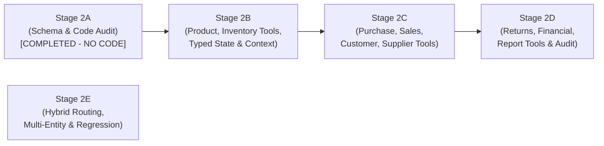

# Auto Parts ERP AI Assistant: Stage 2A Verified Implementation Map

> [!IMPORTANT]
> **READ-ONLY AUDIT MILESTONE (STAGE 2A)**:
> This document presents the comprehensive, read-only architectural and database audit of the Auto Parts ERP backend. It reflects the exact tables, columns, foreign keys, sequences, repository interfaces, and existing AI services as inspected in the live codebase and Flyway migrations `V1` through `V30`.
>
> In accordance with Stage 2A constraints, **zero Java source code, SQL migrations, dependencies, or database schemas have been modified**. This map serves as the verified baseline specification for Stages 2B through 2E.

---

## 1. Executive Summary & Verification Findings

Our audit compared the provisional capabilities in `BUSINESS_QUESTION_COVERAGE.md` against the actual database schema (`src/main/resources/db/migration/`) and Java services/repositories (`src/main/java/com/autoparts/erp/`).

### Key Schema and Architecture Realities Discovered:

1. **Entity Identifier & Column Name Discrepancies Resolved**:
   * **Products**: Unique product code column is `product_code` (renamed from `item_id` in `V7`). Stock quantity column is `qty` (NUMERIC(12, 3)), minimum stock is `minimum_stock` (NUMERIC(12, 3)). Unit is `unit` (default `'PCS'`). Barcode is `barcode` (added in `V26`).
   * **Product Brands**: Master table is `product_brands` (NOT `brands`!). Table stores `name`, `description`, and `active`.
   * **Inventory Structure**: There is **no standalone `inventories` table**. Current on-hand stock is stored directly in `products.qty` (`NUMERIC(12, 3)`), and the reorder threshold is stored in `products.minimum_stock` (`NUMERIC(12, 3)`). Stock movement history is recorded in `inventory_movements`, and stock adjustments in `inventory_adjustments`.
   * **Suppliers**: Name column is `supplier_name` (NOT `name`!). Contact person is `contact_person`, GSTIN is `gstin` (uppercase normalized), payment terms is `payment_terms_days`.
   * **Customers**: Name column is `customer_name` (NOT `name`!). Business identifier is `customer_code` (generated by sequence `customer_code_seq`, format `CUST-######`).
   * **Purchases**: Master table is `purchases`. Line items table is `purchase_products` (renamed from `purchase_items` in `V11`). Number column is `purchase_number` (format `PUR-######`). Supplier invoice is `supplier_invoice_no`. Statuses are `'DRAFT'`, `'RECEIVED'`, `'CANCELLED'`.
   * **Sales**: Master table is `sales`. Line items table is `sales_products` (renamed from `sales_items` in `V11`). Invoice number column is `invoice_number` (format `INV-######`). Customer reference is `customer_id` (foreign key to `customers(id)` added in `V15`). Retail walk-in sales have `customer_name` and `customer_phone` directly on `sales`. Statuses are `'DRAFT'`, `'COMPLETED'`, `'CANCELLED'`. Payment statuses are `'UNPAID'`, `'PARTIALLY_PAID'`, `'PAID'`.
   * **Cash Registers**: Sessions table is `cash_register_sessions`. The closing difference column is `difference_amount` (standardized from `difference` in `V20`).
   * **Expenses**: Table is `expenses` with foreign key `category_id` to `expense_categories`. Amount is `amount` (NUMERIC(14, 2)). Payment methods are `'CASH'`, `'UPI'`, `'CARD'`, `'BANK'`. Statuses are `'ACTIVE'`, `'CANCELLED'`.
   * **Inventory Movements**: Table `inventory_movements` records every stock delta (`quantity_change`, `quantity_before`, `quantity_after`). Reference types: `'PURCHASE'`, `'SALE'`, `'SALES_RETURN'`, `'PURCHASE_RETURN'`, `'ADJUSTMENT'`, `'OPENING_STOCK'`.
   * **Daily Closings**: Table `daily_closings` stores consolidated, pre-aggregated financial and volume metrics for each `business_date`.
   * **Financial & Cost Accounting Limitation (COGS & Profit)**: The ERP system does **not** track a reliable transaction-level historical Cost of Goods Sold (COGS) basis. In `sales_products`, selling price (`unit_price`) is recorded, but historical purchase cost is not. `products.purchase_price` is mutable and fluctuates over time. As documented in `AdvancedReportServiceImpl.java` (lines 151–153, 201–202), certified COGS and gross profit cannot be calculated reliably. The AI assistant must not attempt to calculate certified or indicative gross profit/margins, but rather cleanly explain that reliable historical COGS data is unavailable in the current data model. Supported verified metrics are Sales Revenue (`SUM(grand_total)` for completed sales), Net Revenue (`SUM(taxable_amount)`), Purchase Total (`SUM(grand_total)` for received purchases), Customer Outstanding, Supplier Outstanding, and Operating Expenses.

2. **Repository vs. AI Tool Architecture**:
   * The codebase contains **28 non-AI application repository interfaces and implementations**, plus the AI assistant's internal `AiRepository` / `AiRepositoryImpl` (29 interfaces and 29 implementations total across the project).
   * Existing module repositories (`ProductRepository`, `SupplierRepository`, `CustomerRepository`, `PurchaseRepository`, `SalesRepository`, `ExpenseRepository`) are designed for administrative CRUD operations (`findAll()`, `findByUuid()`, `create()`, `update()`, `deactivate()`).
   * For conversational AI tool queries (fuzzy string matching, case-insensitive partial searches, multi-item comparisons, date intervals, and composite aggregations), tools must execute fast, parameterized SQL via `aiToolJdbcTemplate` configured with a 30-second query timeout and cooperative cancellation checks.
   * Analytical ledger queries (`CustomerLedgerRepository`, `SupplierLedgerRepository`, `PurchaseLedgerRepository`, `SalesLedgerRepository`, `ExpenseLedgerRepository`, `AdvancedReportRepository`) contain verified calculation logic that AI tools can leverage or mirror.

---

## 2. Immutable Execution Context Safeguard (Zero-Trust Security)

To resolve the vulnerability where mutable graph state could potentially be manipulated by LLM outputs or routing transitions, we introduce a **dual-barrier security architecture**:

```
+-------------------------------------------------------------------------------------------------+
|                                 Inbound HTTP Request Thread                                     |
|  AiAssistantController extracts Authentication from SecurityContextHolder                      |
+-------------------------------------------------------------------------------------------------+
                                                |
                                                v
+-------------------------------------------------------------------------------------------------+
|               Trusted Server-Side Construction: ErpAiExecutionContext (Immutable Record)         |
|  - conversationId: UUID                                                                         |
|  - userSubject: String (authentication.getName())                                               |
|  - authorities: Set<String> (authentication.getAuthorities() -> ROLE_ADMIN, ROLE_MANAGER, etc.)  |
|  - requestTimestamp: Instant                                                                    |
+-------------------------------------------------------------------------------------------------+
                                                |
                                                +-----------------------------------------+
                                                |                                         |
                                                v                                         v
+---------------------------------------------------------------+       +-----------------------------------------+
|                  LangGraph4j Execution Pipeline               |       |           Direct Tool Invocation        |
|  - State graph receives read-only reference to context        |       |  - Every sensitive tool method takes    |
|  - Model-generated node outputs CANNOT modify context         |       |    ErpAiExecutionContext as parameter   |
|  - State channel reducer forbids role updates                 |       |  - Tool validates roles independently   |
|                                                               |       |    before running any database query    |
+---------------------------------------------------------------+       +-----------------------------------------+
                                                                                          |
                                                                                          v
                                                                        +-----------------------------------------+
                                                                        |       Backend Authorization Check       |
                                                                        | context.requireAnyRole("ADMIN", ...)    |
                                                                        | If unauthorized -> throws typed         |
                                                                        | ToolAuthorizationException (No DB call) |
                                                                        +-----------------------------------------+
```

### Technical Specification of `ErpAiExecutionContext`

```java
package com.autoparts.erp.ai.security;

import java.time.Instant;
import java.util.Arrays;
import java.util.Collection;
import java.util.Objects;
import java.util.Set;
import java.util.UUID;
import java.util.stream.Collectors;

/**
 * Immutable execution context constructed exclusively by trusted backend services on the HTTP thread.
 * Guarantees defensive immutability: authorities set cannot be mutated by caller references.
 * Never derived, modified, or populated from LLM output, model JSON, or user chat text.
 */
public record ErpAiExecutionContext(
        UUID conversationId,
        String userSubject,
        Set<String> authorities,
        Instant requestTimestamp
) {
    public ErpAiExecutionContext {
        Objects.requireNonNull(conversationId, "conversationId must not be null");
        if (userSubject == null || userSubject.isBlank()) {
            throw new IllegalArgumentException("userSubject must not be null or blank");
        }
        // Defensive copy: Set.copyOf guarantees true immutability and rejects null elements
        authorities = authorities == null ? Set.of() : Set.copyOf(authorities);
        requestTimestamp = requestTimestamp == null ? Instant.now() : requestTimestamp;
    }

    public static ErpAiExecutionContext create(UUID conversationId, String userSubject, Collection<String> grantedRoles) {
        Objects.requireNonNull(conversationId, "conversationId must not be null");
        Objects.requireNonNull(grantedRoles, "grantedRoles must not be null");

        Set<String> normalized = grantedRoles.stream()
                .filter(role -> role != null && !role.isBlank())
                .map(String::trim)
                .collect(Collectors.collectingAndThen(Collectors.toSet(), Set::copyOf));

        return new ErpAiExecutionContext(conversationId, userSubject, normalized, Instant.now());
    }

    public boolean hasRole(String role) {
        if (role == null || role.isBlank()) return false;
        String trimmed = role.trim();
        String normalized = trimmed.startsWith("ROLE_") ? trimmed : "ROLE_" + trimmed;
        return authorities.contains(trimmed) || authorities.contains(normalized);
    }

    public boolean hasAnyRole(String... roles) {
        for (String r : roles) {
            if (hasRole(r)) return true;
        }
        return false;
    }

    public void requireAnyRole(String... roles) {
        if (!hasAnyRole(roles)) {
            throw new ToolAuthorizationException(
                    "Access denied: Requires one of " + Arrays.toString(roles) + " for user '" + userSubject + "'"
            );
        }
    }
}
```

---

## 3. Verified ERP Domain Capability & Schema Map

### Domain A: Product Management

* **Master Tables**: `products` (`p`), `product_categories` (`pc`), `product_brands` (`pb`)
* **Verified Columns**:
  * `p.id`, `p.uuid`, `p.product_code`, `p.part_no`, `p.name`, `p.description`
  * `p.category_id` -> `pc.id` (`pc.name`)
  * `p.brand_id` -> `pb.id` (`pb.name`)
  * `p.purchase_price` (NUMERIC 12,2), `p.selling_price` (NUMERIC 12,2)
  * `p.qty` (NUMERIC 12,3), `p.minimum_stock` (NUMERIC 12,3)
  * `p.unit` (VARCHAR 20, default 'PCS'), `p.active` (BOOLEAN)
  * `p.barcode`, `p.barcode_type` (default 'CODE_128')
* **Existing AI Tool**: `ProductLookupTool.java` (Implements `searchProducts`, `getProductByExactCode`, `compareProducts`, `countActiveProducts`).
* **Verified Query Patterns**:
  * *Search*: `SELECT p.product_code, p.part_no, p.name, p.qty, p.unit, p.selling_price, pc.name as category, pb.name as brand FROM products p JOIN product_categories pc ON p.category_id = pc.id JOIN product_brands pb ON p.brand_id = pb.id WHERE p.active = TRUE AND (LOWER(p.product_code) LIKE LOWER(?) OR LOWER(p.part_no) LIKE LOWER(?) OR LOWER(p.name) LIKE LOWER(?)) LIMIT 20`
  * *Comparison*: `SELECT p.product_code, p.part_no, p.name, p.selling_price, p.qty, p.unit, pc.name as category, pb.name as brand FROM products p JOIN product_categories pc ON p.category_id = pc.id JOIN product_brands pb ON p.brand_id = pb.id WHERE p.active = TRUE AND (LOWER(p.product_code) IN (...) OR LOWER(p.part_no) IN (...))`
* **Role Requirement**: `@SalesAccess` (`ROLE_CASHIER`, `ROLE_MANAGER`, `ROLE_ADMIN`).
* **Stage 2B Scope**: Retain existing `ProductLookupTool`, add `ErpAiExecutionContext` authorization check, wire brand/category search.

---

### Domain B: Inventory Management

* **Master Tables**: `products` (`p`), `inventory_movements` (`im`), `inventory_adjustments` (`ia`)
* **Verified Columns**:
  * `p.qty` (Current stock), `p.minimum_stock` (Reorder point)
  * `im.id`, `im.uuid`, `im.product_id` -> `p.id`
  * `im.movement_type`: `'PURCHASE_RECEIPT'`, `'SALE'`, `'SALES_RETURN'`, `'PURCHASE_RETURN'`, `'ADJUSTMENT'`, `'OPENING_STOCK'`
  * `im.reference_type`: `'PURCHASE'`, `'SALE'`, `'SALES_RETURN'`, `'PURCHASE_RETURN'`, `'ADJUSTMENT'`, `'OPENING_STOCK'`
  * `im.reference_id`: BIGINT foreign key to corresponding transaction table
  * `im.quantity_change`, `im.quantity_before`, `im.quantity_after`
  * `im.notes`, `im.created_at`
  * `ia.id`, `ia.reason`, `ia.notes`, `ia.created_at`
* **Existing AI Tool**: `InventoryHistoryLookupTool.java` (Implements `getProductMovementHistory`, `getProductMovementSummary`, `getProductMovementsByDateRange`).
* **Low Stock Formula**: `p.active = TRUE AND p.qty <= p.minimum_stock ORDER BY p.qty ASC`
* **Role Requirements**:
  * Stock levels & Low stock: `@SalesAccess` (`ROLE_CASHIER`, `ROLE_MANAGER`, `ROLE_ADMIN`).
  * Movement history & adjustments: `@AdminOrManager` (`ROLE_MANAGER`, `ROLE_ADMIN`).
* **Stage 2B Scope**: Add `getLowStockProducts()` tool, enforce `@AdminOrManager` on movement history tools via `ErpAiExecutionContext`.

---

### Domain C: Purchase Management

* **Master Tables**: `purchases` (`pur`), `purchase_products` (`pp`), `suppliers` (`s`), `products` (`p`)
* **Verified Columns**:
  * `pur.id`, `pur.uuid`, `pur.purchase_number`, `pur.supplier_id` -> `s.id`
  * `pur.supplier_invoice_no`, `pur.purchase_date`, `pur.status` (`'DRAFT'`, `'RECEIVED'`, `'CANCELLED'`)
  * `pur.subtotal`, `pur.discount_total`, `pur.tax_total`, `pur.grand_total`
  * `pur.received_at`, `pur.notes`
  * `pp.id`, `pp.purchase_id`, `pp.product_id`, `pp.quantity`, `pp.purchase_price`
  * `pp.discount_amount`, `pp.tax_percent`, `pp.tax_amount`, `pp.line_total`
* **Key Accounting Queries**:
  * *Last Purchase Price (LPP)*:
    `SELECT pp.purchase_price, pur.purchase_date, pur.purchase_number, s.supplier_name FROM purchase_products pp JOIN purchases pur ON pp.purchase_id = pur.id JOIN suppliers s ON pur.supplier_id = s.id WHERE pp.product_id = ? AND pur.status = 'RECEIVED' ORDER BY pur.purchase_date DESC, pur.id DESC LIMIT 1`
  * *Purchases by Supplier*:
    `SELECT pur.purchase_number, pur.purchase_date, pur.supplier_invoice_no, pur.grand_total, pur.status FROM purchases pur JOIN suppliers s ON pur.supplier_id = s.id WHERE LOWER(s.supplier_name) LIKE LOWER(?) ORDER BY pur.purchase_date DESC LIMIT 20`
* **Role Requirement**: `@AdminOrManager` (`ROLE_MANAGER`, `ROLE_ADMIN`). Cashier access is strictly **blocked**.
* **Stage 2C Scope**: Implement `PurchaseAiTools.java` with methods `getPurchaseByNumber`, `getPurchasesBySupplier`, `getPurchasesByDateRange`, `getLastPurchasePrice`.

---

### Domain D: Sales Management

* **Master Tables**: `sales` (`s`), `sales_products` (`sp`), `sales_payments` (`spay`), `customers` (`c`)
* **Verified Columns**:
  * `s.id`, `s.uuid`, `s.invoice_number`, `s.customer_id` -> `c.id` (nullable for walk-in)
  * `s.customer_name`, `s.customer_phone` (snapshot values)
  * `s.sale_date`, `s.status` (`'DRAFT'`, `'COMPLETED'`, `'CANCELLED'`)
  * `s.payment_status` (`'UNPAID'`, `'PARTIALLY_PAID'`, `'PAID'`)
  * `s.subtotal`, `s.discount_amount`, `s.taxable_amount`, `s.total_tax_amount`, `s.grand_total`
  * `s.paid_amount`, `s.balance_amount`
  * `sp.sale_id`, `sp.product_id`, `sp.product_code`, `sp.product_name`, `sp.quantity`, `sp.unit`, `sp.unit_price`, `sp.line_total`
  * `spay.sale_id`, `spay.payment_method` (`'CASH'`, `'UPI'`, `'CARD'`, `'BANK'`, `'CREDIT'`), `spay.amount`, `spay.payment_date`, `spay.reference_number`
* **Key Accounting Queries**:
  * *Invoice Details*: `SELECT s.invoice_number, s.sale_date, COALESCE(c.customer_name, s.customer_name) as customer, s.grand_total, s.paid_amount, s.balance_amount, s.status, s.payment_status FROM sales s LEFT JOIN customers c ON s.customer_id = c.id WHERE LOWER(s.invoice_number) = LOWER(?)`
  * *Sales by Date Range*: `SELECT COUNT(*) as count, SUM(grand_total) as total_sales, SUM(paid_amount) as total_collected, SUM(balance_amount) as total_pending FROM sales WHERE sale_date BETWEEN ? AND ? AND status = 'COMPLETED'`
* **Role Requirement**: `@SalesAccess` (`ROLE_CASHIER`, `ROLE_MANAGER`, `ROLE_ADMIN`).
* **Stage 2C Scope**: Implement `SalesAiTools.java` with methods `getSaleByInvoiceNumber`, `getSalesByCustomer`, `getSalesSummaryByDateRange`.

---

### Domain E: Customer Management & Receivables

* **Master Tables**: `customers` (`c`), `sales` (`s`), `sales_payments` (`spay`), `sales_returns` (`sr`)
* **Verified Columns**:
  * `c.id`, `c.uuid`, `c.customer_code`, `c.customer_name`, `c.phone`, `c.email`
  * `c.address`, `c.city`, `c.state`, `c.pincode`, `c.gstin`, `c.active`
* **Customer Debt Calculation Formula** (from `CustomerLedgerRepository`):
  * `Outstanding Balance = Opening Balance + Total Completed Sales - Total Payments Received - Total Sales Returns`
* **Verified Queries**:
  * *Customer Search*: `SELECT c.customer_code, c.customer_name, c.phone, c.city, c.active FROM customers c WHERE c.active = TRUE AND (LOWER(c.customer_name) LIKE LOWER(?) OR c.phone LIKE ? OR LOWER(c.customer_code) LIKE LOWER(?)) LIMIT 10`
  * *Customer Outstanding Balance*:
    `SELECT c.customer_code, c.customer_name, COALESCE(SUM(s.balance_amount), 0) as pending_balance FROM customers c LEFT JOIN sales s ON s.customer_id = c.id AND s.status = 'COMPLETED' AND s.payment_status IN ('UNPAID', 'PARTIALLY_PAID') WHERE c.id = ? GROUP BY c.id, c.customer_code, c.customer_name`
* **Role Requirement**: `@SalesAccess` (`ROLE_CASHIER`, `ROLE_MANAGER`, `ROLE_ADMIN`).
* **Stage 2C Scope**: Implement `CustomerAiTools.java` with methods `searchCustomers`, `getCustomerDetails`, `getCustomerOutstandingBalance`.

---

### Domain F: Supplier Management & Payables

* **Master Tables**: `suppliers` (`s`), `purchases` (`pur`), `purchase_payments` (`ppay`), `purchase_returns` (`pret`)
* **Verified Columns**:
  * `s.id`, `s.uuid`, `s.supplier_name`, `s.contact_person`, `s.phone`, `s.email`
  * `s.address`, `s.city`, `s.state`, `s.pincode`, `s.gstin`, `s.payment_terms_days`, `s.active`
* **Supplier Debt Calculation Formula** (from `SupplierLedgerRepository`):
  * `Closing Payables = Opening Balance + Total Purchases - Total Payments Made - Total Purchase Returns`
* **Verified Queries**:
  * *Supplier Search*: `SELECT s.uuid, s.supplier_name, s.contact_person, s.phone, s.gstin, s.payment_terms_days FROM suppliers s WHERE s.active = TRUE AND (LOWER(s.supplier_name) LIKE LOWER(?) OR s.phone LIKE ? OR LOWER(s.gstin) LIKE LOWER(?)) LIMIT 10`
  * *Supplier Payables Summary*: Leverage `SupplierLedgerRepository.getSummary(supplier, fromDate, toDate, openingBalance)`.
* **Role Requirements**:
  * Contact info & search: `@SalesAccess` (`ROLE_CASHIER`, `ROLE_MANAGER`, `ROLE_ADMIN`).
  * Payables, debts & ledger balances: `@AdminOrManager` (`ROLE_MANAGER`, `ROLE_ADMIN`).
* **Stage 2C Scope**: Implement `SupplierAiTools.java` with methods `searchSuppliers`, `getSupplierDetails`, `getSupplierPayablesSummary`.

---

### Domain G: Returns, Credits, and Refunds

* **Master Tables**: `sales_returns` (`sr`), `sales_return_products` (`srp`), `sales_refunds` (`srf`), `purchase_returns` (`pr`), `purchase_return_products` (`prp`), `supplier_credits` (`sc`), `supplier_refunds` (`sref`)
* **Verified Columns**:
  * `sr.sale_id`, `sr.return_date`, `sr.reason`, `sr.total_return_amount`, `sr.status` (`'ACCEPTED'`, `'PARTIALLY_REFUNDED'`, `'REFUNDED'`)
  * `srf.sales_return_id`, `srf.payment_method`, `srf.amount`, `srf.refund_date`
  * `pr.return_number`, `pr.purchase_id`, `pr.return_date`, `pr.reason`, `pr.total_return_amount`
  * `sc.purchase_return_id`, `sc.credit_note_number`, `sc.credit_date`, `sc.amount`
  * `sref.supplier_credit_id`, `sref.payment_method`, `sref.amount`, `sref.refund_date`
* **Role Requirements**:
  * Customer Sales Returns & Refunds: `@SalesAccess` (`ROLE_CASHIER`, `ROLE_MANAGER`, `ROLE_ADMIN`).
  * Supplier Purchase Returns & Credits: `@AdminOrManager` (`ROLE_MANAGER`, `ROLE_ADMIN`).
* **Stage 2D Scope**: Implement `ReturnAiTools.java` with methods `getSalesReturnsByInvoice`, `getPurchaseReturnsByPurchaseNumber`.

---

### Domain H: Financial & Cash Management

* **Master Tables**: `cash_registers` (`cr`), `cash_register_sessions` (`crs`), `cash_register_movements` (`crm`), `expenses` (`e`), `expense_categories` (`ec`), `daily_closings` (`dc`)
* **Verified Columns**:
  * `cr.register_code`, `cr.name`, `cr.active`
  * `crs.cash_register_id`, `crs.opening_balance`, `crs.actual_closing_balance`, `crs.expected_closing_balance`, `crs.difference_amount`, `crs.status` (`'OPEN'`, `'CLOSED'`)
  * `crm.session_id`, `crm.movement_type` (`'IN'`, `'OUT'`), `crm.amount`, `crm.description`, `crm.source_type`
  * `e.category_id` -> `ec.id` (`ec.name`), `e.expense_date`, `e.title`, `e.amount`, `e.payment_method`, `e.status` (`'ACTIVE'`, `'CANCELLED'`)
  * `dc.business_date`, `dc.sales_total`, `dc.purchase_total`, `dc.expense_total`, `dc.cash_opening_total`, `dc.cash_actual_total`, `dc.cash_difference_total`
* **Role Requirements**:
  * Cash register active session status: `@SalesAccess` (`ROLE_CASHIER`, `ROLE_MANAGER`, `ROLE_ADMIN`).
  * Expenses, ledgers, and cash register discrepancies: `@AdminOrManager` (`ROLE_MANAGER`, `ROLE_ADMIN`).
  * Daily closing audit: `@AdminOrManager` (`ROLE_MANAGER`, `ROLE_ADMIN`).
* **Stage 2D Scope**: Implement `FinancialAiTools.java` with methods `getOpenCashRegisterStatus`, `getExpenseSummaryByDateRange`, `getDailyClosingByDate`.

---

### Domain I: Advanced Reports & Business Analytics

* **Master Repositories**: `ReportRepository`, `AdvancedReportRepository`
* **Verified Analytical Capabilities**:
  * `ReportRepository.getSalesSummary(fromDate, toDate, ...)`: Gross sales (`COALESCE(SUM(grand_total), 0)`), net sales (`COALESCE(SUM(taxable_amount), 0)`), tax, collections, outstanding total from `sales` where `status = 'COMPLETED'`.
  * `ReportRepository.getPurchaseSummary(fromDate, toDate, ...)`: Total purchases (`COALESCE(SUM(grand_total), 0)`), payments, outstanding from `purchases` where `status = 'RECEIVED'`.
  * `ReportRepository.getExpenseSummary(fromDate, toDate)`: Total expense by category and payment method from `expenses` where `status = 'ACTIVE'`.
  * `AdvancedReportRepository.findInventoryMetrics(...)`: ABC classification (revenue share) and XYZ classification (demand volatility).
  * `AdvancedReportRepository.findCustomerMetrics(...)`: RFM segmentation (Recency, Frequency, Monetary).
  * `AdvancedReportRepository.findSupplierMetrics(...)`: Supplier fulfillment and volume analytics.
  * `AdvancedReportRepository.findReconciliationDiscrepancies(...)`: Cross-ledger reconciliation discrepancies.
* **Critical Cost & Profit Limitation (COGS & Gross Profit)**:
  * *Data Model Reality*: The ERP system does **not** record a reliable transaction-level historical Cost of Goods Sold (COGS) basis. `sales_products` records the unit selling price at transaction time, but does not record the unit purchase cost. The master `products.purchase_price` is mutable and fluctuates over time as new purchase orders are received.
  * *Codebase Evidence*: `AdvancedReportServiceImpl.java` (lines 151–153, 201–202, 270–271) explicitly disables gross margin, product profitability, and gross profit simulations:
    > *"No inventory valuation, GMROI, turnover, or product profitability is returned: the system does not record a reliable inventory-costing/COGS basis."*
    > *"Gross profit is not simulated because the current inventory model does not provide reliable transaction-level cost of goods sold."*
  * *Operational AI Boundary*: The AI assistant must **never calculate, simulate, or present certified COGS or gross profit**. When asked about gross profit, net margin, or product profitability, the assistant must cleanly and transparently explain that reliable historical COGS data is unavailable in the current data model. Indicative margin calculations based on current master `purchase_price` are strictly prohibited unless separately authorized.
* **Role Requirements**:
  * Standard KPI summaries: `@AdminOrManager` (`ROLE_MANAGER`, `ROLE_ADMIN`).
  * ABC/XYZ inventory & RFM customer cohorts: `@AdminOrManager` (`ROLE_MANAGER`, `ROLE_ADMIN`).
  * Financial reconciliation discrepancies & data quality audits: `@AdminOnly` (`ROLE_ADMIN`).
* **Stage 2D Scope**: Implement `ReportAiTools.java` with methods `getKpiSummary`, `getInventoryAbcXyzAnalysis`, `getCustomerRfmAnalysis`, `getReconciliationDiscrepancies`.

---

### Domain J: Audit Logging & AI Diagnostics

* **Master Tables**: `audit_logs` (`al`), `ai_conversations`, `ai_messages`, `ai_tool_runs`, `ai_agent_runs`
* **Verified Columns**:
  * `al.username`, `al.action`, `al.entity_type`, `al.entity_id`, `al.description`, `al.created_at`
  * `ai_tool_runs.conversation_id`, `ai_tool_runs.user_subject`, `ai_tool_runs.tool_name`, `ai_tool_runs.arguments`, `ai_tool_runs.result`, `ai_tool_runs.status`, `ai_tool_runs.error_message`
* **Role Requirement**: `@AdminOnly` (`ROLE_ADMIN`).
* **Stage 2D Scope**: Implement audit lookup tool and instrument all AI tool executions to record audit entries in `ai_tool_runs`.

---

## 4. Stage 2 Sub-Stage Execution Plan

To ensure rigorous quality control and eliminate risk across ERP modules, Stage 2 is executed in five sequential sub-stages:



| Sub-Stage | Focus Area | Deliverables | Verification Gate |
| :--- | :--- | :--- | :--- |
| **Stage 2A** | Read-Only Audit & Verified Map | `STAGE_2A_VERIFIED_IMPLEMENTATION_MAP.md`, updated `ARCHITECTURE.md`, `IMPLEMENTATION_PLAN.md`, `IMPLEMENTATION_STATUS.md`. **Zero code changes.** | User review and approval of audit findings |
| **Stage 2B** | Core Inventory, Products & Security Context | `ErpAiExecutionContext.java`, `ToolAuthorizationException.java`, typed `ErpAiGraphState.java` channels, updated `ProductLookupTool`, updated `InventoryHistoryLookupTool`, low-stock tool, asynchronous security tests. | Unit & security test suite passes |
| **Stage 2C** | Commercial ERP Domains | `PurchaseAiTools.java`, `SalesAiTools.java`, `CustomerAiTools.java`, `SupplierAiTools.java`, parameterized JDBC queries, commercial role enforcement. | Commercial query tests pass |
| **Stage 2D** | Operations, Finance & Reporting | `ReturnAiTools.java`, `FinancialAiTools.java`, `ReportAiTools.java`, audit logging in `ai_tool_runs`, AdminOnly reconciliation tools. | Financial & report tests pass |
| **Stage 2E** | Routing, Context & Synthesis | Upgraded `ErpAiIntentClassifier` (multi-domain hybrid), upgraded `ErpAiConversationContextResolver` (multi-entity), dynamic `ErpAiGraphNodes`, end-to-end regression tests. | 100% test pass; Stage 2 complete |

---

## 5. Summary of Code Adjustments for Stage 2B

When approved for Stage 2B, implementation will strictly adhere to the following 6 core requirements:

1. **Never Authorize from Graph-State Roles Alone**:
   Every protected tool method receives the trusted `ErpAiExecutionContext` through a server-controlled invocation parameter. Authorization is independent of any mutable graph channel or LLM generated state.
2. **Authorize Before JDBC Execution (Zero DB Call Guarantee)**:
   Tool authorization checks (`context.requireAnyRole(...)`) execute before opening JDBC statements or submitting queries to `aiToolJdbcTemplate`. Unit tests must explicitly verify that unauthorized requests trigger a `ToolAuthorizationException` with **zero** database interactions.
3. **Test Asynchronous Security Isolation**:
   Include concurrent test scenarios with different users holding different authorities (e.g. User A with `ROLE_CASHIER` and User B with `ROLE_MANAGER`). Verify that under asynchronous thread execution, User A's context cannot leak into User B's execution and vice versa.
4. **Preserve Existing Behavior and Tests**:
   All existing unit and mock tests in `ProductLookupToolTest`, `ProductLookupToolComparisonTest`, and `InventoryHistoryLookupToolTest` must continue passing cleanly after integrating `ErpAiExecutionContext`.
5. **Careful Dead Code Review Before Removal**:
   Before removing `AiToolRegistry.java`, perform a comprehensive inspection across all Spring configuration, application properties, tests, reflection usages, and dependency injection points to guarantee zero references exist.
6. **Operation-Specific Permissions**:
   Product search, product details, and current stock levels must require `@SalesAccess` (`ROLE_CASHIER`, `ROLE_MANAGER`, `ROLE_ADMIN`), whereas inventory movement history and adjustments must require `@AdminOrManager` (`ROLE_MANAGER`, `ROLE_ADMIN`). These permissions must remain distinct and operation-specific, never accidentally merged.

### Specific Implementation Tasks for Stage 2B:
1. **Create `com.autoparts.erp.ai.security.ErpAiExecutionContext`**: Server-created immutable record with `Set.copyOf()` defensive copy and strict validation.
2. **Create `com.autoparts.erp.ai.security.ToolAuthorizationException`**: Typed security exception.
3. **Controller & Service Hook**: In `AiAssistantController.java` and `AiAssistantService.java`, extract `authentication.getAuthorities()` on the HTTP request thread and construct `ErpAiExecutionContext`.
4. **Typed LangGraph4j State Channels**: Update `ErpAiGraphState.SCHEMA` with verified `Channels.base(...)` signatures.
5. **Tool Refactoring**: Pass `ErpAiExecutionContext` to `ProductLookupTool` and `InventoryHistoryLookupTool`, validating `@SalesAccess` and `@AdminOrManager` respectively.
6. **Low-Stock Tool Addition**: Implement `getLowStockProducts()` inside inventory tools with `@SalesAccess` check.
7. **Clean up Dead Prototype**: Safely delete unreferenced `AiToolRegistry.java`.
8. **Asynchronous Security Tests**: Add unit and integration tests verifying context propagation and isolation across worker thread pools.
