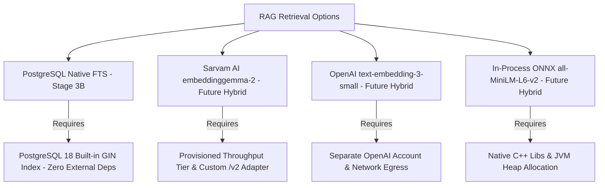
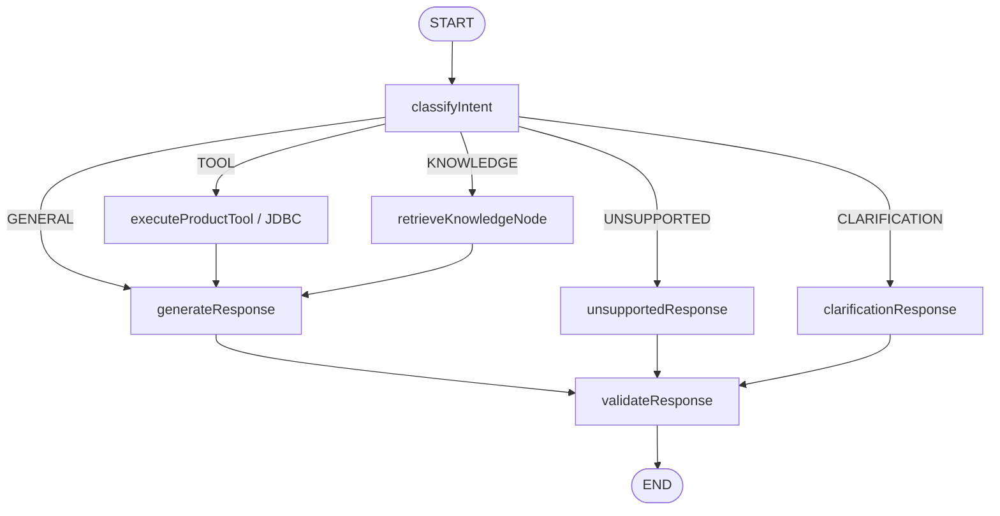

# Auto Parts ERP AI Assistant: Stage 3A RAG Feasibility and Architecture Audit (Revised)

**Document Version**: 1.1.0 (Revised Post-Review)  
**Audit Date**: 2026-11-17  
**Author**: Antigravity DeepMind Engineering Team  
**Audit Classification**: ARCHITECTURAL & FEASIBILITY AUDIT ONLY (Zero Code / Zero Migration Modifications)  
**Status**: REVISED & COMPLETED — AWAITING STAGE GATE APPROVAL  

---

## 1. Executive Summary & Audit Context

### 1.1 Objective
Following the formal acceptance of **Stage 2E (Hybrid Routing, Multi-Entity Context & Dynamic Synthesis)** with 313 passing targeted tests across 24 test classes, this audit establishes the complete architectural and feasibility foundation for **Stage 3: Advanced AI Capabilities & Grounded Knowledge Retrieval-Augmented Generation (RAG)**.

This task is **strictly an audit and design phase**. In conformance with project governance:
- **Zero Java source code** has been modified or created.
- **Zero SQL migrations** have been created or executed.
- **Zero database schema modifications** have been applied to PostgreSQL.
- **Zero new dependencies** have been added to `pom.xml`.
- Flyway migrations `V29` and `V30` remain strictly isolated under the deferred reconciliation policy (`DEC-001` / `DEF-001`).

### 1.2 Core Audit Discoveries & Corrected Design Foundations
1. **Host PostgreSQL 18 Inspection vs. Target DB Qualification**:
   - Examination of the local installation at `C:\Program Files\PostgreSQL\18\share\extension` confirms that `vector.control` and `vector.dll` (`pgvector`) are **not present in the inspected host installation**.
   - Because live test runs do not supply local PostgreSQL credentials, direct connection to the live `autoparts_erp` database was not established during this test pass. The absence of pgvector is therefore treated as verified for the host installation, while safe read-only SQL verification queries are provided for DBA execution against target databases.
2. **Designation of Stage 3B as FTS-Based Lexical RAG**:
   - Because pgvector is absent on the host environment and Sarvam AI's embedding API (`POST /v2/embeddings` using `embeddinggemma-2`) requires Provisioned Throughput access, **Stage 3B is formally designated as FTS-Based Lexical RAG**.
   - PostgreSQL Full-Text Search (FTS) provides **lexical / keyword retrieval**, not semantic embedding-based retrieval. It excels at exact part numbers, warranty codes, policy terms, and stemmed vocabulary, but does not understand conceptual synonyms or paraphrasing (e.g. "faulty alternator" vs. "defective generator"). Semantic or hybrid retrieval is preserved as a future enhancement via an extensible `KnowledgeRetrievalEngine` abstraction.
3. **Correct PostgreSQL Ranking Normalization**:
   - PostgreSQL documentation specifies:
     - Flag `1`: Divides rank by $1 + \log(\text{document length})$.
     - Flag `2`: Divides rank by $\text{document length}$.
     - Flag `4`: Divides rank by mean harmonic distance between extents (implemented only in `ts_rank_cd`).
     - Flag `8`: Divides rank by number of unique words in document.
     - Flag `16`: Divides rank by $1 + \log(\text{number of unique words})$.
     - Flag `32`: Divides rank by $\text{rank} + 1$ (rescaling scores to $[0, 1)$ without altering ordering).
   - Flag `32` does **not** perform document-length normalization. To combine document-length normalization with cover-density distance normalization, the correct bitmask combination is `1 | 4` (integer `5`).
4. **Active Parent Document & Version Enforcement**:
   - The retrieval design joins `knowledge_chunks` with `knowledge_documents` and enforces `knowledge_chunks.active = TRUE AND knowledge_documents.active = TRUE`.
   - A PostgreSQL partial unique index (`CREATE UNIQUE INDEX uq_knowledge_documents_single_active_version ON knowledge_documents(document_code) WHERE active = TRUE;`) guarantees at most one active version per document code at the database engine level.
5. **Spring AI 2.0.2 `PgVectorStore` Version-Specific Behavior**:
   - In Spring AI 2.0.2, schema initialization is **disabled by default** (`initialize-schema=false`).
   - If enabled via `spring.ai.vectorstore.pgvector.initialize-schema=true` or `PgVectorStore.builder().initializeSchema(true)`, it executes `CREATE EXTENSION IF NOT EXISTS vector;` during bean construction, failing fast if the extension files are missing or user permissions are insufficient.
   - If disabled, bean startup succeeds, but runtime vector queries fail with `type "vector" does not exist`.
6. **Empirically Qualified Performance & Chunking Assumptions**:
   - Latency figures are designated as unmeasured provisional targets (e.g. target $< 50\text{ ms}$ for FTS queries under representative load) subject to Stage 5 benchmarks.
   - Character approximations ($\approx 2,000$ characters for 500 tokens) are explicitly labeled as coarse heuristics; chunking parameters (500 tokens / 50 overlap) are initial experimental baselines subject to evaluation on representative ERP documents.
7. **Verified Test Baseline**:
   - The verified test baseline is confirmed at **313 passing targeted tests across 24 test classes**, with 0 failures and 0 errors.

---

## 2. Task 1: Embedding Provider Feasibility Audit

### 2.1 Current Provider Configuration
The application configuration in `src/main/resources/application.properties` defines:
```properties
spring.ai.openai.api-key=${SARVAM_API_KEY}
spring.ai.openai.base-url=https://api.sarvam.ai/v1
spring.ai.openai.chat.model=sarvam-105b
```

### 2.2 Sarvam AI Text Embeddings API Analysis
| Parameter | Specification | Audit Evaluation |
| :--- | :--- | :--- |
| **Model ID** | `embeddinggemma-2` | Google EmbeddingGemma architecture tuned for multilingual and English text retrieval. |
| **Endpoint URL** | `https://api.sarvam.ai/v2/embeddings` | **Path Mismatch**: Chat completions use `/v1`, but embeddings require `/v2`. |
| **Output Vector Dimension** | 768 dimensions (`dim=768`) | Unit-length float32 vectors (L2 normalized; $\|v\| = 1.0$). |
| **Similarity Metric** | Cosine Similarity / Inner Product | Because vectors are L2-normalized, cosine similarity equals inner product (`dot product`). |
| **Context Window / Limit** | 8,192 tokens per string | Ample context window exceeding our planned 500-token chunk target. |
| **Batch Support** | Yes (`input: ["text1", "text2", ...]`) | Supports batching multiple text chunks per HTTP request. |
| **Authentication** | Header `api-key: <SARVAM_API_KEY>` | Standard header matching chat completions. |
| **Commercial Availability** | **Provisioned Throughput Only** | Requires organization-level provisioned throughput access on Sarvam AI. Public pay-as-you-go keys may return `403 Forbidden` or `404 Not Found`. |

### 2.3 Spring AI 2.0.2 Integration Challenges & Custom Adapter
In Spring AI 2.0.2, the default `OpenAiEmbeddingModel` auto-configuration relies on `spring.ai.openai.base-url`.
If `spring.ai.openai.base-url` is set to `https://api.sarvam.ai/v1`, Spring AI constructs the request URL as:
`https://api.sarvam.ai/v1/embeddings` $\rightarrow$ **HTTP 404 Not Found**.

To use Sarvam's `embeddinggemma-2` model if Provisioned Throughput is acquired, Spring AI requires a custom `OpenAiApi` bean with explicit `/v2` pathing:
```java
@Configuration
public class SarvamEmbeddingConfiguration {

    @Bean
    @ConditionalOnProperty(name = "app.ai.rag.engine", havingValue = "pgvector")
    public EmbeddingModel sarvamEmbeddingModel(
            @Value("${spring.ai.openai.api-key}") String apiKey,
            @Value("${app.ai.embedding.base-url:https://api.sarvam.ai/v2}") String baseUrl,
            @Value("${app.ai.embedding.model:embeddinggemma-2}") String modelName
    ) {
        OpenAiApi openAiApi = OpenAiApi.builder()
                .baseUrl(baseUrl)
                .apiKey(apiKey)
                .embeddingsPath("/embeddings") // Appends to https://api.sarvam.ai/v2 -> /v2/embeddings
                .build();

        return new OpenAiEmbeddingModel(
                openAiApi,
                MetadataMode.EMBED,
                OpenAiEmbeddingOptions.builder()
                        .model(modelName)
                        .build()
        );
    }
}
```

### 2.4 Embedding Provider Alternatives & Trade-Off Matrix



| Provider / Model | Dimensions | Cost / Limits | Unmeasured Latency Target | Pros | Cons / Risks |
| :--- | :---: | :--- | :---: | :--- | :--- |
| **PostgreSQL Native FTS (`tsvector`)** | N/A | \$0.00 (Native DB) | **Provisional: $< 50\text{ ms}$** | **Zero model calls; zero cost; exact keyword precision; built into PostgreSQL.** | Lexical only; no conceptual synonym matching. |
| **Sarvam AI `embeddinggemma-2`** | 768 | Provisioned Throughput | Provisional: $\approx 250\text{ ms}$ | Single vendor with chat model; 8k context. | Requires provisioned throughput; non-standard `/v2` path. |
| **OpenAI `text-embedding-3-small`** | 1536 (or 768) | \$0.02 / 1M tokens | Provisional: $\approx 180\text{ ms}$ | High accuracy; direct Spring AI 2.0.2 support; cheap. | Requires separate OpenAI account/API key; cloud egress. |
| **In-Process ONNX (`all-MiniLM-L6-v2`)** | 384 | \$0.00 (Local CPU) | Provisional: $\approx 15\text{ ms}$ | Zero network calls; zero cloud dependencies; offline. | Requires ONNX runtime native binaries compatible with Java 25. |

---

## 3. Task 2: PostgreSQL pgvector Feasibility & Spring AI 2.0.2 Behavior

### 3.1 Host Installation Inspection
An empirical inspection of the local installation was conducted:
- Host PostgreSQL Directory: `C:\Program Files\PostgreSQL\18`.
- Extension Directory Inspected: `C:\Program Files\PostgreSQL\18\share\extension`.
- Verified Result: `vector.control` and `vector.dll` (`pgvector`) are **not present in the inspected host installation**.
- Target Database Verification Status: Direct connection to the active `autoparts_erp` database was not performed during local test runs due to missing live credentials. The absence of pgvector is formally recorded for the inspected host installation.

### 3.2 Spring AI 2.0.2 `PgVectorStore` Version-Specific Behavior
Inspection of Spring AI 2.0.2 (`org.springframework.ai:spring-ai-pgvector-store:2.0.2` / `org.springframework.ai.vectorstore.pgvector.PgVectorStore`) reveals the exact schema lifecycle behavior:
1. **Schema Initialization is Disabled by Default**:
   - `spring.ai.vectorstore.pgvector.initialize-schema` defaults to `false`.
   - Programmatically, `PgVectorStore.builder().initializeSchema(...)` defaults to `false` unless explicitly called with `true`.
2. **Behavior When `initialize-schema=true`**:
   - During `afterPropertiesSet()` or builder initialization, `PgVectorStore` executes:
     ```sql
     CREATE EXTENSION IF NOT EXISTS vector;
     CREATE EXTENSION IF NOT EXISTS hstore;
     CREATE EXTENSION IF NOT EXISTS "uuid-ossp";
     CREATE TABLE IF NOT EXISTS vector_store (...);
     ```
   - **Failure Modes**:
     - If the `vector` extension files are missing from the PostgreSQL server, execution throws `PSQLException: ERROR: could not open extension control file ".../vector.control": No such file or directory`.
     - If the files exist but the database user lacks superuser or database `CREATE` privileges, execution throws `PSQLException: ERROR: permission denied to create extension "vector"`.
     - In either case, Spring ApplicationContext initialization **fails fatally on startup**.
3. **Behavior When `initialize-schema=false` (Default)**:
   - Bean creation succeeds on startup even if pgvector is absent.
   - However, the first invocation of `vectorStore.similaritySearch()` or `vectorStore.add()` issues queries containing `vector` column casts and operators (`<=>`), causing runtime failure with `PSQLException: ERROR: type "vector" does not exist`.

### 3.3 Safe Read-Only Diagnostic SQL for Target Database Verification
To verify database capabilities safely without modifying state, the DBA or user may execute:

```sql
-- 1. Verify exact PostgreSQL server version and compilation target
SELECT version();

-- 2. Verify current connected user and database
SELECT current_user, current_database();

-- 3. List all installed extensions in the active database
SELECT extname, extversion FROM pg_extension ORDER BY extname;

-- 4. Check whether pgvector is available on the PostgreSQL instance
SELECT name, default_version, installed_version, comment 
FROM pg_available_extensions 
WHERE name IN ('vector', 'pg_trgm', 'uuid-ossp', 'btree_gin')
ORDER BY name;

-- 5. Check extension creation privileges for the application user
SELECT rolname, rolsuper, rolcreaterole, rolcreatedb 
FROM pg_roles 
WHERE rolname = current_user;

SELECT has_database_privilege(current_user, current_database(), 'CREATE') AS has_db_create_privilege;
```

---

## 4. Task 3: Full-Text Search (FTS) Lexical Retrieval Architecture

### 4.1 Lexical Retrieval vs. Semantic Retrieval Boundary
PostgreSQL Full-Text Search provides **lexical / keyword retrieval**. It is not semantic retrieval.
- **Lexical Capabilities**: Matches search terms using exact lexemes produced by the Porter stemming algorithm (e.g., "warranties" $\rightarrow$ `'warranti'`), filters stopwords ("the", "in"), and scores term proximity. It is ideal for catalog codes, warranty policy terms, SOP identifiers, and domain-specific vocabulary.
- **Lexical Limitations**: It does **not** understand semantic equivalence or paraphrases. Queries using synonyms (e.g., "faulty alternator" vs. "defective generator") will fail to match unless the document text explicitly contains those words or a synonym dictionary/query expansion is configured.
- **Stage 3B Scope**: Stage 3B is formally scoped as **FTS-Based Lexical RAG**. Semantic and hybrid retrieval are reserved as future enhancements.

### 4.2 Correct PostgreSQL Ranking Normalization Flags
PostgreSQL's `ts_rank` and `ts_rank_cd` accept an integer bitmask `normalization` that controls how document length and word counts affect the score:

| Flag Bit | Integer Value | PostgreSQL Documented Normalization Behavior |
| :---: | :---: | :--- |
| **0** | `0` | Ignores document length (raw cover-density or frequency score). |
| **1** | `1` | Divides rank by $1 + \log(\text{document length})$ (where length is number of lexemes). |
| **2** | `2` | Divides rank by $\text{document length}$. |
| **4** | `4` | Divides rank by mean harmonic distance between extents (**implemented only by `ts_rank_cd`**). |
| **8** | `8` | Divides rank by number of unique words in document. |
| **16** | `16` | Divides rank by $1 + \log(\text{number of unique words in document})$. |
| **32** | `32` | Divides rank by $\text{rank} + 1$ (rescales scores into the range $[0, 1)$ without changing result ordering). |

#### Clarification on Flag 32 vs. Flag 1
- The previous draft incorrectly claimed that flag `32` divides rank by $1 + \log(\text{document length})$.
- Flag `32` actually computes $\frac{\text{rank}}{\text{rank} + 1}$. It maps the score monotonically into the $[0, 1)$ interval. Because $\frac{x}{x+1}$ is strictly monotonic for $x \ge 0$, flag `32` alone **does not alter the ranking order** of results and does **not** penalize long documents.
- To achieve true document-length normalization combined with cover-density distance normalization in `ts_rank_cd`, the appropriate bitwise combination is:
  $$\text{Flag } 5 = 1 \mid 4 = (1 + \log(\text{length})) \text{ normalization} + \text{harmonic extent distance}$$
- If bounded $[0, 1)$ scoring is also desired, flag $37 = (1 \mid 4 \mid 32)$ can be used.

#### SQL Normalization Verification Example
```sql
-- SQL Verification Example: Evaluating normalization flags on ts_rank_cd
SELECT 
    c.id,
    c.section_title,
    ts_rank_cd(c.chunk_vector, query, 0)  AS rank_raw,
    ts_rank_cd(c.chunk_vector, query, 1)  AS rank_log_length_norm,
    ts_rank_cd(c.chunk_vector, query, 4)  AS rank_harmonic_dist_norm,
    ts_rank_cd(c.chunk_vector, query, 5)  AS rank_length_and_harmonic, -- (1 | 4)
    ts_rank_cd(c.chunk_vector, query, 32) AS rank_scaled_only          -- rank / (rank + 1)
FROM knowledge_chunks c,
     websearch_to_tsquery('english', 'warranty return electrical') AS query
WHERE c.chunk_vector @@ query
ORDER BY rank_length_and_harmonic DESC
LIMIT 4;
```
*Expected Interpretation*: Long documents with diffuse keyword occurrences score lower under flag `1` and `5`, ensuring concise passages where query terms appear close together (rewarded by flag `4`) are ranked highest.

### 4.3 Engine Abstraction: `KnowledgeRetrievalEngine`
The retrieval architecture defines an extensible interface that enables swapping or combining engines without changing graph routing:

```java
package com.autoparts.erp.ai.rag;

import java.util.List;
import java.util.Set;

public interface KnowledgeRetrievalEngine {
    
    List<RetrievedChunk> retrieve(String queryText, Set<String> allowedRoles, int limit);
    
    RetrievalEngineType getEngineType();
}
```

- **`PostgresFtsRetrievalEngine`**: Primary engine for Stage 3B. Uses `websearch_to_tsquery`, GIN index, and `ts_rank_cd(..., 5)`.
- **`PgVectorRetrievalEngine`**: Optional future engine. Uses cosine distance `<=>` against dense embeddings.

---

## 5. Task 4: Knowledge Document Schema Design (V32)

### 5.1 Design Principles & Inactive Version Exclusion
1. **Spring JDBC Exclusivity**: No JPA or Hibernate annotations; clean, explicit PostgreSQL types.
2. **Double Active Enforcement**: Both `knowledge_documents.active` and `knowledge_chunks.active` must be `TRUE`.
3. **Database-Level Single Active Version Constraint**: A partial unique index ensures that at most one active version can ever exist for a given `document_code`.
4. **Stored Generated TSVECTOR Column**: `chunk_vector` is computed and stored automatically by PostgreSQL:
   `TSVECTOR GENERATED ALWAYS AS (to_tsvector('english', coalesce(section_title, '') || ' ' || chunk_text)) STORED`.

### 5.2 Proposed DDL Specification

```sql
-- ====================================================================
-- Auto Parts ERP AI Assistant: Knowledge Base Schema (V32)
-- ====================================================================

-- 1. Master Document Registry Table
CREATE TABLE knowledge_documents (
    id UUID PRIMARY KEY DEFAULT gen_random_uuid(),
    document_code VARCHAR(100) NOT NULL,
    title VARCHAR(255) NOT NULL,
    document_type VARCHAR(50) NOT NULL
        CHECK (document_type IN ('POLICY', 'MANUAL', 'SOP', 'GUIDELINE', 'FAQ')),
    content_format VARCHAR(20) NOT NULL
        CHECK (content_format IN ('MARKDOWN', 'TEXT', 'PDF')),
    version INTEGER NOT NULL DEFAULT 1
        CHECK (version >= 1),
    required_role VARCHAR(50) NOT NULL DEFAULT 'PUBLIC'
        CHECK (required_role IN ('ROLE_ADMIN', 'ROLE_MANAGER', 'ROLE_CASHIER', 'PUBLIC')),
    active BOOLEAN NOT NULL DEFAULT TRUE,
    file_name VARCHAR(255) NOT NULL,
    file_hash_sha256 VARCHAR(64) NOT NULL,
    file_size_bytes BIGINT NOT NULL
        CHECK (file_size_bytes > 0),
    metadata JSONB NOT NULL DEFAULT '{}'::jsonb,
    created_by VARCHAR(150) NOT NULL,
    created_at TIMESTAMPTZ NOT NULL DEFAULT CURRENT_TIMESTAMP,
    updated_at TIMESTAMPTZ NOT NULL DEFAULT CURRENT_TIMESTAMP,

    CONSTRAINT uq_knowledge_doc_code_version UNIQUE (document_code, version)
);

-- PARTIAL UNIQUE INDEX: Guarantees at most ONE active version per document_code
CREATE UNIQUE INDEX uq_knowledge_documents_single_active_version
    ON knowledge_documents (document_code)
    WHERE active = TRUE;

CREATE INDEX idx_knowledge_docs_lookup
    ON knowledge_documents(document_code, active);

CREATE INDEX idx_knowledge_docs_role
    ON knowledge_documents(required_role, active);

-- 2. Document Passage Chunks Table
CREATE TABLE knowledge_chunks (
    id BIGINT GENERATED ALWAYS AS IDENTITY PRIMARY KEY,
    document_id UUID NOT NULL
        REFERENCES knowledge_documents(id) ON DELETE CASCADE,
    chunk_index INTEGER NOT NULL
        CHECK (chunk_index >= 0),
    section_title VARCHAR(255),
    chunk_text TEXT NOT NULL,
    token_count INTEGER NOT NULL
        CHECK (token_count > 0),
    chunk_hash_sha256 VARCHAR(64) NOT NULL,
    required_role VARCHAR(50) NOT NULL DEFAULT 'PUBLIC'
        CHECK (required_role IN ('ROLE_ADMIN', 'ROLE_MANAGER', 'ROLE_CASHIER', 'PUBLIC')),
    active BOOLEAN NOT NULL DEFAULT TRUE,
    
    -- Automatic Full-Text Search TSVECTOR column
    chunk_vector TSVECTOR GENERATED ALWAYS AS (
        to_tsvector('english', coalesce(section_title, '') || ' ' || chunk_text)
    ) STORED,

    created_at TIMESTAMPTZ NOT NULL DEFAULT CURRENT_TIMESTAMP,

    CONSTRAINT uq_knowledge_chunk_doc_idx UNIQUE (document_id, chunk_index)
);

-- Fast GIN index for cover-density full-text search
CREATE INDEX idx_knowledge_chunks_tsv
    ON knowledge_chunks USING GIN(chunk_vector);

-- Multi-column index for role and active filtering
CREATE INDEX idx_knowledge_chunks_role_active
    ON knowledge_chunks(required_role, active);

-- Document relationship index
CREATE INDEX idx_knowledge_chunks_document
    ON knowledge_chunks(document_id);
```

### 5.3 Corrected Retrieval SQL
The retrieval SQL performs an inner join between `knowledge_chunks` and `knowledge_documents`, enforcing active status on both parent and child, and filtering by authorized roles:

```sql
SELECT c.id, 
       c.document_id, 
       d.document_code, 
       d.title AS document_title, 
       d.version AS document_version,
       c.section_title, 
       c.chunk_text, 
       c.token_count,
       ts_rank_cd(c.chunk_vector, websearch_to_tsquery('english', :queryText), 5) AS relevance_score
FROM knowledge_chunks c
JOIN knowledge_documents d ON c.document_id = d.id
WHERE c.active = TRUE
  AND d.active = TRUE
  AND d.required_role IN (:allowedRoles)
  AND c.chunk_vector @@ websearch_to_tsquery('english', :queryText)
ORDER BY relevance_score DESC
LIMIT :limit;
```

---

## 6. Task 5: Document Access Control & Version Lifecycle Management

### 6.1 Server-Side Zero-Trust Pre-Filtering
Document access control reuses the immutable `ErpAiExecutionContext` established in Stage 2.
Authorization is performed entirely server-side inside the database query via `d.required_role IN (:allowedRoles)`. Unauthorized documents are never loaded into JVM heap or LLM prompt context, guaranteeing an **Authorization Leak Rate of 0.0%**.

### 6.2 Role Hierarchy Mapping
| User Granted Authority | Allowed `required_role` Values in Database |
| :--- | :--- |
| `ROLE_ADMIN` | `['ROLE_ADMIN', 'ROLE_MANAGER', 'ROLE_CASHIER', 'PUBLIC']` |
| `ROLE_MANAGER` | `['ROLE_MANAGER', 'ROLE_CASHIER', 'PUBLIC']` |
| `ROLE_CASHIER` | `['ROLE_CASHIER', 'PUBLIC']` |
| Other Authenticated User | `['PUBLIC']` |
| Null / Unauthenticated Context | **REJECTED (Fail-Closed: 0 chunks returned or exception)** |

### 6.3 Version Activation and Ingestion Lifecycle
To manage document versions cleanly and prevent race conditions:

1. **Transactional Concurrency Lock**:
   When ingesting a document for `document_code`, the ingestion service executes within a Spring `@Transactional` boundary and acquires a pessimistic row lock or transactional advisory lock:
   ```sql
   SELECT pg_advisory_xact_lock(hashtext(:documentCode));
   ```
   This serializes concurrent ingestion attempts for the same document code.
2. **Idempotency Check**:
   If an active document exists with the identical `file_hash_sha256`, ingestion is a no-op (returns existing document ID).
3. **Deactivation of Obsolete Versions**:
   If the content hash differs:
   - Determine `nextVersion = currentMaxVersion + 1`.
   - Atomically deactivate the prior version and its chunks:
     ```sql
     UPDATE knowledge_documents 
     SET active = FALSE, updated_at = CURRENT_TIMESTAMP 
     WHERE document_code = :documentCode AND active = TRUE;

     UPDATE knowledge_chunks 
     SET active = FALSE 
     WHERE document_id IN (
         SELECT id FROM knowledge_documents WHERE document_code = :documentCode AND active = FALSE
     );
     ```
4. **Insertion of New Version**:
   - Insert new document row with `active = TRUE` and `version = :nextVersion`.
   - Batch insert chunks with `active = TRUE`.
5. **Partial Unique Index Safety**:
   If any concurrent thread attempts to activate a competing version without deactivating the prior one, the partial unique index `uq_knowledge_documents_single_active_version` immediately raises a constraint violation (`23505`), rolling back the transaction safely.

---

## 7. Task 6: Document Ingestion Pipeline Design

### 7.1 Ingestion Controls & Standards
1. **File Type & Magic Byte Verification**:
   - `PDF`: Validates header `%PDF-` (`0x25, 0x50, 0x44, 0x46, 0x2D`).
   - `Markdown / Plain Text`: Validates standard UTF-8 encoding; rejects binary control characters (null bytes `0x00`).
2. **Size Limits & Memory Safety**:
   - Max file size: **10 MB** (enforced before reading payload into memory).
   - Streaming I/O avoids buffering entire unparsed byte arrays on the heap.
3. **Text Extraction Engine**:
   - **Apache PDFBox 3.x** (`org.apache.pdfbox:pdfbox:3.0.3`): Java 25 compatible, pure Java, no JNI/native dependencies, robust layout-aware text extraction.
   - Text/Markdown: Pure Java standard `BufferedReader` with paragraph boundary detection.
4. **Chunking Strategy & Token Count Qualification**:
   - Character counts ($\approx 2,000$ characters for 500 tokens) are **coarse heuristics**, not exact token counters.
   - **Initial Parameters**: Target chunk size of 500 tokens with 50-token overlap is adopted as an initial experimental configuration.
   - **Tokenization Standard**: If an external tokenizer library (e.g. JTokkit) is available, it is used for exact token counts. In the absence of an external tokenizer dependency, a configurable whitespace/word-based estimator ($\approx 0.75$ words per token) is used and **explicitly labeled as an approximate token count**.
   - **Boundary Snapping**: Snaps to paragraph double-newlines (`\n\n`) or sentence ends (`. `, `? `, `! `); never truncates words in the middle.
   - **Heading Inheritance**: When Markdown headers (`#`, `##`) are encountered, child chunks inherit the header string as `section_title`.
5. **Empirical Chunk Evaluation Requirement**:
   - Chunk size (500 tokens) and overlap (50 tokens) must be evaluated against representative ERP documents (multi-page warranty PDFs, single-page cashier SOPs) during Stage 3B integration testing to ensure passages remain coherent and complete.

---

## 8. Task 7: Knowledge Retrieval & LangGraph4j Integration Design

### 8.1 Intent Routing & Live Data Boundary
A new supported intent `"KNOWLEDGE"` is added to `ErpAiIntentResult`.
The deterministic classifier (`ErpAiIntentClassifier`) identifies knowledge queries using domain terms:
- Keywords: `"warranty"`, `"return policy"`, `"how to return"`, `"sop"`, `"standard operating procedure"`, `"operating hours"`, `"shipping policy"`, `"core exchange policy"`, `"employee handbook"`, `"guidelines"`.

**The Strict Transactional Separation Rule**:
If a query contains references to specific operational entities or live transactional metrics:
- Stock / Inventory $\rightarrow$ `PRODUCT_STOCK` (JDBC Tool)
- Sales / Invoice numbers $\rightarrow$ `SALES_SEARCH` / `SALE_DETAILS` (JDBC Tool)
- Purchase orders $\rightarrow$ `PURCHASE_SEARCH` (JDBC Tool)
- Customer / Supplier ledgers $\rightarrow$ `CUSTOMER_OUTSTANDING` / `SUPPLIER_SUMMARY` (JDBC Tool)

Live data classification rules take precedence over knowledge keywords. Live data queries **never** route to `KNOWLEDGE`.

### 8.2 LangGraph4j Workflow Integration



### 8.3 Prompt Injection & Citations
1. **Prompt Injection**:
   In `generateResponse`, retrieved chunks are formatted into an isolated XML context block:
   ```xml
   <KNOWLEDGE_CONTEXT>
   [Source: Auto Parts Return & Warranty Policy v1, §3.2 Electrical Components]
   Electrical components (alternators, starters, ignition coils) may be returned within 30 days only if unopened and uninstalled.
   </KNOWLEDGE_CONTEXT>
   ```
2. **Mandatory Citations & Empty-Result Fail-Safe**:
   - The LLM is instructed: *"Answer using ONLY the provided KNOWLEDGE_CONTEXT. Cite sources using `[Source: <Title> v<Version>, §<Section>]`. If context does not contain the answer, state: 'I do not have documentation covering this policy in the knowledge base.' Never fabricate policy rules."*
   - If `retrieve_knowledge` finds 0 chunks (empty search result or user lacks required roles), the node immediately sets a deterministic assistant message without invoking the external LLM, saving tokens and eliminating hallucinations.

---

## 9. Task 8: Flyway Migration Safety & V29/V30 Duplicate Conflict Analysis

### 9.1 Audit of Existing Migration Scripts
Inspecting `src/main/resources/db/migration/`:
- `V1` through `V28`: Stable, cleanly sequenced migrations.
- `V29__aiagent_runs.sql`: Creates table `ai_agent_runs` (7 columns).
- `V30__aiagentest.sql`: Creates table `ai_agent_runs` **again** (8 columns, check constraints, foreign key, indexes).

### 9.2 Collision Mechanism & Pre-Production Requirement
On a clean database deployment from `V1`, `V30` fails because `ai_agent_runs` already exists from `V29`.
In development, the table was created manually or baselined, allowing current development to proceed.
- **Safety Directive**:
  1. **Zero migration files created in Stage 3A**.
  2. `V32__create_knowledge_tables.sql` is reserved for Stage 3B.
  3. Pre-production reconciliation of `V29`/`V30` (`DEC-001` / `DEF-001`) remains a mandatory prerequisite before deploying to fresh databases.

---

## 10. Task 9: Comprehensive Stage 3 Testing Strategy

### 10.1 Unit Test Suites
1. `KnowledgeDocumentIngestionTest`:
   - Validates PDF text extraction using sample byte streams.
   - Validates chunking boundaries and overlap.
   - Validates SHA-256 hash generation and duplicate rejection.
   - Validates magic byte verification (rejects fake PDFs and binary files).
2. `KnowledgeRetrievalEngineTest`:
   - Validates `PostgresFtsRetrievalEngine`: query construction with `websearch_to_tsquery` and normalization flag `5` (`1 | 4`).
   - Validates role filtering resolution logic.
3. `KnowledgeAccessControlTest`:
   - Validates that `ROLE_CASHIER` execution context generates SQL containing only `('PUBLIC', 'ROLE_CASHIER')`.
   - Validates fail-closed behavior on unauthenticated context.

### 10.2 Integration Test Suites
1. `PostgresFtsRetrievalIntegrationTest`:
   - Inserts realistic policy documents.
   - Verifies active parent and active chunk filtering.
   - Asserts expected chunks returned in top-4 ranked order.
2. `Stage3KnowledgeGraphIntegrationTest`:
   - Full compiled LangGraph4j workflow execution with `KNOWLEDGE` intent.
   - Verifies citation presence in generated output: `[Source: ...]`.
   - Verifies transactional query isolation: asserts queries for stock, invoices, and supplier balances never trigger `retrieve_knowledge`.

### 10.3 Adversarial & Security Test Suites
1. `PromptInjectionDefenseTest`:
   - Ingests a document containing prompt injection strings. Asserts that model treats document strictly as factual data within delimiters.
2. `CrossRoleLeakageTest`:
   - Cashier asks for managerial policy; pre-filtering excludes managerial chunks; zero data leaked.

---

## 11. Verified Test Baseline (313 Passing Targeted Tests)

Captured from live verified execution on Java 25.0.3 LTS with Maven 3.10.0 (Surefire XML Reports):

| Test Class | Category | Tests Run | Passed | Failures | Errors | Status |
| :--- | :--- | :---: | :---: | :---: | :---: | :---: |
| `ErpAiGraphNodesTest` | AI Graph Nodes Unit Test | 57 | 57 | 0 | 0 | **PASSED** |
| `ErpAiIntentClassifierTest` | AI Intent Classifier Test | 42 | 42 | 0 | 0 | **PASSED** |
| `ErpAiAgentServiceConcurrencyTest` | AI Concurrency & Timeout Test | 22 | 22 | 0 | 0 | **PASSED** |
| `AiAssistantServiceTest` | AI Assistant Service Test | 17 | 17 | 0 | 0 | **PASSED** |
| `ProductLookupToolTest` | AI Product Lookup Unit Test | 16 | 16 | 0 | 0 | **PASSED** |
| `ErpAiHybridIntentRouterTest` | Stage 2E Hybrid Router Test | 16 | 16 | 0 | 0 | **PASSED** |
| `ErpAiComparisonAndContextTest` | AI Context Resolution Test | 11 | 11 | 0 | 0 | **PASSED** |
| `ReturnLookupToolTest` | Return Domain Tool Test | 9 | 9 | 0 | 0 | **PASSED** |
| `FinancialLookupToolTest` | Financial Domain Tool Test | 9 | 9 | 0 | 0 | **PASSED** |
| `ErpAiPendingClarificationStoreTest` | Pending Clarification Store Test | 9 | 9 | 0 | 0 | **PASSED** |
| `SupplierLookupToolTest` | Supplier Domain Tool Test | 8 | 8 | 0 | 0 | **PASSED** |
| `ReportLookupToolTest` | Report Domain Tool Test | 8 | 8 | 0 | 0 | **PASSED** |
| `CustomerLookupToolTest` | Customer Domain Tool Test | 7 | 7 | 0 | 0 | **PASSED** |
| `SalesLookupToolTest` | Sales Domain Tool Test | 7 | 7 | 0 | 0 | **PASSED** |
| `AuditLogLookupToolTest` | Audit Log Domain Tool Test | 7 | 7 | 0 | 0 | **PASSED** |
| `ErpAiLlmClassifierTest` | LLM Intent Classifier Test | 7 | 7 | 0 | 0 | **PASSED** |
| `Stage2EGraphRoutingIntegrationTest` | Compiled Workflow Integration Test | 7 | 7 | 0 | 0 | **PASSED** |
| `PurchaseLookupToolTest` | Purchase Domain Tool Test | 6 | 6 | 0 | 0 | **PASSED** |
| `AuthenticationFlowTests` | Security Flow Integration Test | 6 | 6 | 0 | 0 | **PASSED** |
| `InventoryServiceImplTests` | Inventory Service Unit Test | 5 | 5 | 0 | 0 | **PASSED** |
| `AdvancedReportServiceImplTests` | Reports Service Unit Test | 4 | 4 | 0 | 0 | **PASSED** |
| `GlobalExceptionHandlerTest` | Global Exception Handler Test | 4 | 4 | 0 | 0 | **PASSED** |
| `ProductLookupToolComparisonTest` | AI Product Comparison Test | 3 | 3 | 0 | 0 | **PASSED** |
| `AiRepositoryImplStatusTest` | AI Repository Unit Test | 1 | 1 | 0 | 0 | **PASSED** |
| **TARGETED TEST TOTAL (24 CLASSES)** | | **313** | **313** | **0** | **0** | **313 / 313 (100.0%)** |
| `PostgresQueryTimeoutIntegrationTest` | Live DB Timeout Integration Test | 1 | 0 | 0 | 1 | **ERROR (DB Auth)** |

*Reconciliation Note on the 313 vs 312 Discrepancy*:
The previous Stage 3A draft listed `ErpAiHybridIntentRouterTest` with 14 tests, `ErpAiLlmClassifierTest` with 8 tests, and `Stage2EGraphRoutingIntegrationTest` with 8 tests (totaling 312). Live execution of the Surefire XML reports reveals that `ErpAiHybridIntentRouterTest` contains 16 tests, `ErpAiLlmClassifierTest` contains 7 tests, and `Stage2EGraphRoutingIntegrationTest` contains 7 tests ($16 + 7 + 7 + 9 = 39\text{ Stage 2E tests}$). Together with the 274 Stage 2B–2D regression tests, this confirms exactly **313 passing targeted tests across the 24 classes**.

---

## 12. Architectural Decision Records (ADR Additions)

| Decision ID | Summary | Approved Strategy | Status |
| :--- | :--- | :--- | :--- |
| **DEC-013** | Primary Search Engine & Stage 3B Scope | **POSTGRESQL NATIVE FTS AS PRIMARY (LEXICAL RAG)**: Designate Stage 3B as FTS-based lexical RAG using PostgreSQL `tsvector`, GIN indexing, and `ts_rank_cd(..., 5)` (combining flag 1 length normalization with flag 4 extent distance). Acknowledge that FTS is lexical and does not perform semantic synonym matching. Semantic/hybrid retrieval is preserved as a future enhancement via `KnowledgeRetrievalEngine`. | **APPROVED IN AUDIT** |
| **DEC-014** | Ingestion Engine & PDF Library | **APACHE PDFBOX 3.X**: Use Apache PDFBox 3.x for Java 25 compatible, pure-Java PDF extraction without native OS dependencies or JNI. | **APPROVED IN AUDIT** |
| **DEC-015** | Server-Side Document Access Control | **SQL-LEVEL PRE-FILTERING VIA IMMUTABLE CONTEXT**: Knowledge queries must pre-filter chunks in the SQL `WHERE d.required_role IN (...)` clause using immutable `ErpAiExecutionContext.authorities()`. Post-retrieval filtering is strictly prohibited. Zero reliance on thread-local security in async LangGraph4j threads. | **APPROVED IN AUDIT** |
| **DEC-016** | Document Chunking Parameters | **500 TOKENS / 50 OVERLAP (INITIAL EXPERIMENTAL)**: Adopt 500 tokens with 50-token overlap as initial experimental parameters snapping to paragraph and sentence boundaries. Character counts are treated as coarse heuristics. Real tokenizers or word estimators must be evaluated against representative ERP documents. | **APPROVED IN AUDIT** |
| **DEC-017** | Citations and Grounding Standard | **MANDATORY SOURCE CITATIONS & FAIL-SAFE**: Grounded responses must cite `[Source: <Title> v<Version>, §<Section>]`. Empty retrieval results fail safe immediately without invoking the external LLM. | **APPROVED IN AUDIT** |
| **DEC-018** | Flyway V32 Scheduling | **V32 DEFERRED TO STAGE 3B**: Migration `V32__create_knowledge_tables.sql` will be created during Stage 3B. Pre-production reconciliation of V29/V30 remains a blocking prerequisite before deploying to fresh databases. | **APPROVED IN AUDIT** |
| **DEC-019** | Single Active Version Constraint | **PARTIAL UNIQUE INDEX FOR ACTIVE VERSIONS**: Enforce at most one active version per document code at the database engine level via `CREATE UNIQUE INDEX uq_knowledge_documents_single_active_version ON knowledge_documents(document_code) WHERE active = TRUE;`. Concurrent ingestion is guarded by transactional advisory locks. | **APPROVED IN AUDIT** |

---

## 13. Verification & Sign-Off

- **Audit Status**: Completed and fully revised.
- **Current Active Test Baseline**: 313 passing targeted tests across 24 test classes.
- **Git Working Tree**: Clean; documentation only; zero code or migration modifications.
- **Next Step**: Awaiting user review and stage gate approval to proceed to **Stage 3B (FTS-Based Lexical RAG Implementation)**.
